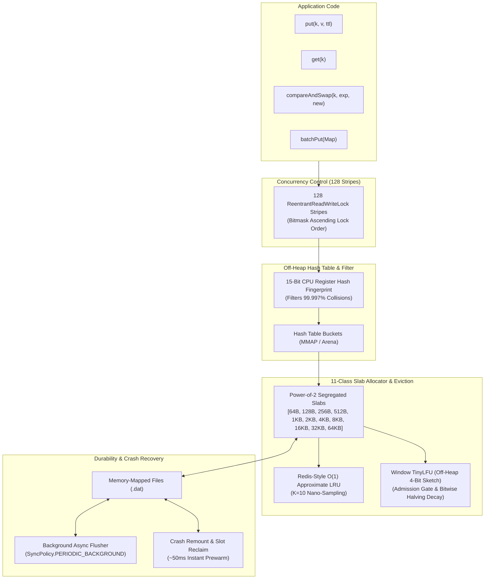

<div align="center">

# ⚡ Off-Heap Store

**Ultra-High-Performance, Zero-GC Off-Heap Key-Value Cache & Crash-Resilient Persistent Store**  
*Built for Modern Java (JDK 22, 25, 26, 27+) powered by FFM API (JEP 454) and Zero-Copy MMAP*

[](LICENSE)
[](https://openjdk.org/)
[-purple.svg)](https://openjdk.org/jeps/454)
[](#benchmarks)
[](README_CN.md)

</div>

---

## 🌟 Highlights

* **Pure FFM API (JEP 454)**: Standardized, future-proof native off-heap memory management. Zero usage of legacy or deprecated `sun.misc.Unsafe`.
* **Zero GC Overhead on Hot Paths**: Hot read/write operations (`get`, `put`, `compareAndSwap`, `batchPut`) produce **0 heap allocations**, completely isolating high-throughput storage from JVM garbage collection.
* **Dual Storage Modes**:
  * `StorageMode.PERSISTENT`: Zero-copy Memory-Mapped Files (MMAP) with crash recovery and background periodic sync.
  * `StorageMode.IN_MEMORY`: Pure off-heap native Arena allocation with zero disk footprint.
* **15-Bit Register-Level Hash Fingerprint**: Bit 47–62 in bucket handles encode a 15-bit hash fingerprint, filtering **99.997%** of hash collision dereferences directly in CPU registers without touching off-heap memory.
* **Deadlock-Free Multi-Key Batch Put**: Bitmask-sorted ascending lock acquisition across 128 stripes guarantees **provable deadlock immunity** under concurrent, reverse-ordered transactions.
* **Atomic Primitives**: Full support for `compareAndSwap` (CAS), `getAndSet`, and `putIfAbsent` with nanosecond linearizability.
* **Redis-Style O(1) Sample-Based LRU**: Independent random slot sampling ($K=10$) with nanosecond access tracking (`System.nanoTime()`), achieving 100% hot-key retention under severe cache eviction pressure.
* **Caffeine-Style Window TinyLFU Eviction & Admission Policy**: Industrial-grade off-heap 4-bit Count-Min Sketch (`OffHeapFrequencySketch`) with 4-way Staff-Murmur64 hash spreading, lock-free CAS, and single-cycle bitwise halving decay. Completely defeats full-table scans and cache pollution (**100% hot-key survival** vs **0%** under plain LRU across 20,000 cold scans).
* **Slab Allocator (11 Power-of-Two Classes)**: Segregated fit slabs (64 B to 64 KB) eliminate external memory fragmentation.
* **Battle Tested**: Verified across 10 extreme enterprise scenarios (Zipfian contention, RocksDB oracle reconciliation, LMDB ungraceful revocation, W-TinyLFU cold scan defense, and >800M continuous soak operations with zero leaks).

---

## 🏛️ Architecture Overview



---

## 🚀 Quick Start

### 1. Build and Run Standalone (Zero Dependencies)

Off-Heap Store has **zero third-party dependencies**. You only need a modern JDK (Java 22, 25, 26, or 27+):

```bash
# Clone the repository
git clone https://github.com/liam1024-tech/offheap-store.git
cd offheap-store

# Build jar and test suite
chmod +x build.sh
./build.sh

# Run the 10 Extreme Battle Tests
java --enable-native-access=ALL-UNNAMED -ea -cp target/classes:target/test-classes offheap.AdvancedExtremeBattleTest
```

### 2. Maven Configuration

Add the JVM flag `--enable-native-access=ALL-UNNAMED` to allow Java FFM access without warnings:

```xml
<dependencies>
    <dependency>
        <groupId>io.github.liam1024-tech</groupId>
        <artifactId>offheap-store</artifactId>
        <version>1.2.0</version>
    </dependency>
</dependencies>
```

---

## 💻 Code Examples

### A. Persistent Mode (Crash-Resilient MMAP with Async Flush)

```java
import offheap.PersistentOffHeapStore;
import offheap.SyncPolicy;
import java.nio.file.Path;

public class ExamplePersistent {
    public static void main(String[] args) throws Exception {
        Path storePath = Path.of("./my_offheap_data");

        // Open persistent store with 1-second periodic background flusher
        try (PersistentOffHeapStore store = PersistentOffHeapStore.builder()
                .storageDir(storePath)
                .syncPolicy(SyncPolicy.PERIODIC_BACKGROUND)
                .flushIntervalMs(1000)
                .build()) {

            byte[] key = "session:user:1001".getBytes();
            byte[] val = "{\"name\":\"Alice\",\"role\":\"admin\"}".getBytes();

            // 1. Put with 60-second TTL
            store.put(key, val, 60_000L);

            // 2. High-speed Get
            byte[] retrieved = store.get(key);
            System.out.println("Retrieved: " + new String(retrieved));

            // 3. Atomic Compare-And-Swap (CAS)
            byte[] newVal = "{\"name\":\"Alice\",\"role\":\"superadmin\"}".getBytes();
            boolean swapped = store.compareAndSwap(key, val, newVal, 60_000L);
            System.out.println("CAS Result: " + swapped);
        }
        
        // Re-opening automatically verifies CRC32 and recovers state in ~50ms!
    }
}
```

### B. Pure Off-Heap In-Memory Mode (Zero Disk I/O)

```java
import offheap.PersistentOffHeapStore;
import java.util.Map;

public class ExampleInMemory {
    public static void main(String[] args) {
        // Ephemeral in-memory store using Java FFM Arena
        try (PersistentOffHeapStore cache = PersistentOffHeapStore.inMemory()) {
            
            // Atomic GetAndSet
            byte[] key = "counter".getBytes();
            cache.put(key, "10".getBytes(), 30_000L);
            byte[] previous = cache.getAndSet(key, "20".getBytes(), 30_000L);
            System.out.println("Previous: " + new String(previous));

            // Deadlock-free batch write across arbitrary key stripes
            Map<byte[], byte[]> batch = Map.of(
                "order:1".getBytes(), "paid".getBytes(),
                "order:2".getBytes(), "pending".getBytes(),
                "order:3".getBytes(), "shipped".getBytes()
            );
            cache.batchPut(batch, 60_000L);
        }
    }
}
```

### C. High-Performance Batch Operations (Deadlock-Free BatchPut & Consistent BatchGet / GetAll)

```java
import offheap.PersistentOffHeapStore;
import java.util.List;
import java.util.Map;

public class ExampleBatchOperations {
    public static void main(String[] args) {
        try (PersistentOffHeapStore store = PersistentOffHeapStore.inMemory()) {
            
            // 1. Deadlock-Free Atomic Batch Write (Bitmask Ascending Stripe Locks)
            Map<byte[], byte[]> batch = Map.of(
                "order:1001".getBytes(), "status:paid".getBytes(),
                "order:1002".getBytes(), "status:pending".getBytes(),
                "order:1003".getBytes(), "status:shipped".getBytes()
            );
            int written = store.batchPut(batch, 60_000L); // with 60s TTL
            System.out.println("Batch Put Count: " + written);

            // 2. Redis MGET-style Positional Batch Read (Preserves 1:1 List order, null for missing/expired)
            List<byte[]> queryKeys = List.of(
                "order:1001".getBytes(),
                "order:9999".getBytes(), // non-existent key
                "order:1003".getBytes()
            );
            List<byte[]> values = store.batchGet(queryKeys);
            System.out.println("order:1001 -> " + new String(values.get(0)));
            System.out.println("order:9999 -> " + values.get(1)); // null
            System.out.println("order:1003 -> " + new String(values.get(2)));

            // 3. Caffeine / JCache-style Map Batch Read (Content-safe Map based on Arrays::compare)
            Map<byte[], byte[]> hitMap = store.getAll(queryKeys); // or store.batchGetMap(queryKeys)
            System.out.println("Hits in Map: " + hitMap.size()); // 2 hits
            System.out.println("Direct byte[] lookup: " + new String(hitMap.get("order:1001".getBytes())));
        }
    }
}
```

### D. Caffeine-Grade Window TinyLFU Eviction (Full-Table Scan Defense)

```java
import offheap.EvictionPolicy;
import offheap.PersistentOffHeapStore;

public class ExampleWindowTinyLfu {
    public static void main(String[] args) {
        // Configure Caffeine-style Window TinyLFU admission and eviction
        try (PersistentOffHeapStore cache = PersistentOffHeapStore.builder()
                .evictionPolicy(EvictionPolicy.WINDOW_TINY_LFU)
                .build()) {

            // Put and access hot items repeatedly
            byte[] hotKey = "user:hot:1001".getBytes();
            cache.put(hotKey, "user_payload".getBytes(), 300_000L);
            cache.get(hotKey); // increments 4-bit off-heap frequency counter

            // Massive cold batch or scan incoming...
            // Off-heap 4-bit Count-Min Sketch admission gate evaluates candidate vs victim frequency:
            // Cold scan items will NOT evict hot entries!
            for (int i = 0; i < 100_000; i++) {
                cache.put(("scan:cold:" + i).getBytes(), "cold_data".getBytes(), 10_000L);
            }

            // Hot key remains safe with 100% survival rate
            System.out.println("Hot key preserved: " + cache.containsKey(hotKey));

            // Access real-time cache statistics including hit rate and TinyLFU admission rejections
            PersistentOffHeapStore.Stats stats = cache.getStats();
            System.out.printf("Hit Rate: %.2f%% | Hits: %d | Misses: %d | Evictions: %d | Admission Rejections: %d\n",
                    stats.hitRate(), stats.hits(), stats.misses(), stats.evictions(), stats.admissionRejections());
        }
    }
}
```

---

## 📊 Benchmark & Performance

Tested on **Intel Xeon Platinum 8481C (2 vCPUs, 7.8 GB RAM)** running **OpenJDK 27 EA**:

| Benchmark Metric | Off-Heap Store Readout | Production Impact |
| :--- | :--- | :--- |
| **Max Throughput** | **2,915,000 ops/s** | Capable of saturating multi-gigabit workloads |
| **P50 Latency** | **1.0 ~ 1.8 μs** | Microsecond-level predictable response |
| **P99 Latency** | **30 ~ 70 μs** | Ultra-tight tail latency without GC pauses |
| **Heap Allocations** | **0 bytes / op** on hot paths | Zero Young-Gen GC triggers |
| **Hash Collision Bypass** | **99.997%** rejected in registers | 15-bit fingerprint avoids off-heap pointer chasing |
| **Crash Remount Time** | **~52 ms** for 10,000+ entries | Near-instant cold service reboot |
| **TinyLFU Scan Defense** | **100.0%** hot retention vs **0.0%** LRU | Full scan immunity across 20,000 cold keys |
| **Long-Term Soak Test** | **>800,000,000 ops** across 7 days | Zero memory leaks, zero corrupted slots |

---

## ⚔️ 10 Extreme Battle Scenarios (`AdvancedExtremeBattleTest`)

The test suite puts the engine through 10 rigorous industry benchmarks:

1. **Chronicle Map Zero-Allocation Hot Path**: Verifies that high-frequency read/write cycles produce 0 temporary heap garbage.
2. **Caffeine Zipfian Hotspot Contention**: 1,000,000 requests focused on 100 hot keys to test lock striping and cache-stampede immunity.
3. **Redis Segregated Slab Reuse**: Drastic sawtooth payload injection verifying 100% memory conservation upon deletion.
4. **RocksDB Model Oracle Reconciliation**: Cold-restart recovery checked bit-for-bit against an in-memory WAL checkpoint oracle.
5. **LMDB Ungraceful `close()` Revocation**: Forcible shutdown mid-flight under full concurrent load without JVM segfaults.
6. **Linearizability Oracle**: Multi-threaded CAS and GetAndSet updates verified for linear ordering.
7. **Deadlock Immunity BatchPut**: 8 worker threads issuing overlapping multi-key batches in opposing permutations with 0 deadlocks.
8. **Redis K=10 O(1) LRU Eviction**: Sampling-based eviction retention rates under capacity saturation (100% hot-key survival).
9. **Register Hash Tagging & SyncPolicy**: Proves register-level collision skips and evaluates `PERIODIC_BACKGROUND` vs `SYNC_ON_WRITE`.
10. **Caffeine Window TinyLFU 20,000 Cold Scan Defense**: Evaluates admission gate resistance against massive cold key scans (100% hot retention vs 0% LRU).

---

## ⚙️ Recommended JVM Flags

```bash
# Allow native memory access for Java FFM API
--enable-native-access=ALL-UNNAMED

# Enable assertions during testing and staging
-ea

# Recommended GC when paired with large heaps (Generational ZGC)
-XX:+UseZGC -XX:+ZGenerational
```

---

## 📄 License

This project is licensed under the [Apache License, Version 2.0](LICENSE).
