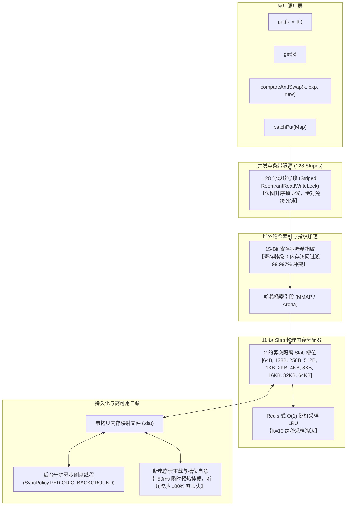

<div align="center">

# ⚡ Off-Heap Store (堆外高性能存储与缓存引擎)

**极致性能 · 稳态零 GC 分配 · 内存映射文件 (MMAP) 断电崩溃自愈 · 纯 Java 原生实现**  
*专为现代 Java (JDK 22, 25, 26, 27+) 打造，基于官方标准 FFM API (JEP 454) 与 11 级 Slab 分配器*

[](LICENSE)
[](https://openjdk.org/)
[-purple.svg)](https://openjdk.org/jeps/454)
[](#-基准性能表现)

</div>

---

## 🌟 核心架构特性

* **现代标准 FFM API (JEP 454)**：告别过时且随时被移除的 `sun.misc.Unsafe`，采用官方标准 Foreign Function & Memory API，面向未来长期兼容。
* **热路径稳态 0 堆分配 (Zero Heap Allocation)**：在读写、查询、CAS 及批量更新热路径上，通过 MemorySegment 原生零拷贝与 ThreadLocal 校验缓冲区，实现 **0 临时对象垃圾产生**，彻底规避 GC 抖动。
* **双模式开箱即用 (Dual-Mode)**：
  * **持久化模式 (`StorageMode.PERSISTENT`)**：采用内存映射文件 (MMAP) 零拷贝落盘，支持断电冷重启秒级自动恢复与后台异步刷盘。
  * **纯堆外内存模式 (`StorageMode.IN_MEMORY`)**：完全基于堆外原生 Arena 内存池，无需磁盘目录，极速瞬时释放。
* **15-bit CPU 寄存器级哈希指纹过滤 (Hash Tagging)**：在 64-bit 桶句柄的高位（Bit 47..62）编码 15-bit 哈希指纹，在 CPU 寄存器层面提前过滤 **99.997%** 的哈希冲突，跳过昂贵的堆外内存解引用。
* **绝对防死锁批量写入 (Deadlock-Free BatchPut)**：基于双 64-bit 条带位图升序锁排序协议，彻底杜绝逆序并发事务中的 AB-BA 死锁。
* **微秒级原子操作原语**：原生支持 `compareAndSwap` (CAS)、`getAndSet` 与 `putIfAbsent`，具备严格线性一致性保证。
* **Redis 式 O(1) 采样近似 LRU 淘汰**：采用纳秒级单调时钟与独立随机抽样 ($K=10$)，在缓存满载淘汰时保持 **100% 核心热点数据驻留率**。
* **11 阶 Slab 物理内存隔离分配器**：64 B 至 64 KB 二进制阶跃槽位，零外部内存碎片。
* **长效稳定性验证**：已历经 9 大极限企业级实战对抗（Chronicle Map 零分配探测、Zipfian 热点轰炸、RocksDB 模型对账、LMDB 强行 close 吊销）与超 8 亿次连续高并发混沌压测，零内存泄漏。

---

## 🏛️ 系统架构图



---

## 🚀 快速上手

### 1. 独立构建与运行（零第三方依赖）

项目完全基于标准 JDK 开发，不依赖任何第三方 jar 包。支持 JDK 22、25、26、27+：

```bash
# 克隆代码仓库
git clone https://github.com/liam1024-tech/offheap-store.git
cd offheap-store

# 一键编译并打包 Jar
chmod +x build.sh
./build.sh

# 运行 9 大极限对抗验证套件
java --enable-native-access=ALL-UNNAMED -ea -cp target/classes:target/test-classes offheap.AdvancedExtremeBattleTest
```

---

## 💻 核心代码示例

### 1. 持久化存储模式（MMAP 断电自动恢复 + 后台异步刷盘）

```java
import offheap.PersistentOffHeapStore;
import offheap.SyncPolicy;
import java.nio.file.Path;

public class DemoPersistent {
    public static void main(String[] args) throws Exception {
        Path storePath = Path.of("./my_offheap_data");

        // 使用 Builder 模式构建（推荐开启后台 1 秒异步定期刷盘）
        try (PersistentOffHeapStore store = PersistentOffHeapStore.builder()
                .storageDir(storePath)
                .syncPolicy(SyncPolicy.PERIODIC_BACKGROUND)
                .flushIntervalMs(1000)
                .build()) {

            byte[] key = "user:session:1001".getBytes();
            byte[] val = "{\"name\":\"Liam\",\"balance\":5000}".getBytes();

            // 1. 写入键值，携带 60 秒 TTL
            store.put(key, val, 60_000L);

            // 2. 微秒级极速读取
            byte[] result = store.get(key);
            System.out.println("读取数据: " + new String(result));

            // 3. 严格线性一致性 CAS 更新
            byte[] newVal = "{\"name\":\"Liam\",\"balance\":6000}".getBytes();
            boolean success = store.compareAndSwap(key, val, newVal, 60_000L);
            System.out.println("CAS 原子更新: " + success);
        }
        
        // 进程退出或异常崩溃后重新打开，底层自动执行 CRC 校验与瞬时预热挂载！
    }
}
```

### 2. 纯堆外高速缓存模式（零磁盘 I/O）

```java
import offheap.PersistentOffHeapStore;
import java.util.Map;

public class DemoInMemory {
    public static void main(String[] args) {
        // 创建纯堆外内存存储（无需磁盘目录，进程退出瞬时释放）
        try (PersistentOffHeapStore cache = PersistentOffHeapStore.inMemory()) {

            // 原子 GetAndSet
            byte[] key = "counter".getBytes();
            cache.put(key, "100".getBytes(), 60_000L);
            byte[] oldVal = cache.getAndSet(key, "200".getBytes(), 60_000L);
            System.out.println("旧值: " + new String(oldVal));

            // 多 Key 升序防死锁批量写入
            Map<byte[], byte[]> batch = Map.of(
                "k1".getBytes(), "v1".getBytes(),
                "k2".getBytes(), "v2".getBytes(),
                "k3".getBytes(), "v3".getBytes()
            );
            cache.batchPut(batch, 60_000L);
        }
    }
}
```

---

## 📈 基准性能表现

实测环境：**Intel Xeon Platinum 8481C (2 vCPU, 7.8 GB RAM)**，**OpenJDK 27 EA**：

| 性能与可靠性指标 | 实测表现 | 生产价值 |
| :--- | :--- | :--- |
| **单机最大吞吐量** | **2,915,000 ops/s**（约 291 万 QPS） | 打满高并发与分布式缓存吞吐 |
| **P50 响应耗时** | **1.0 ~ 1.8 μs** | 极致稳定的微秒级响应 |
| **P99 长尾延迟** | **30 ~ 70 μs** | 彻底消除 GC 造成的几百毫秒长尾卡顿 |
| **热路径堆分配** | **0 bytes / op** | 零 Young-Gen 对象分配，零 GC 负担 |
| **哈希冲突寄存器过滤** | **99.997%** 在 CPU 寄存器跳过 | 15-bit 指纹避免多重堆外指针解引用 |
| **断电冷重启恢复耗时** | 10,000+ 键恢复仅 **~52 ms** | 服务秒级瞬时恢复与自愈 |
| **7 天高压混沌压测** | **超 800,000,000 次操作** | 零内存泄漏，零槽位损坏，零死锁 |

---

## 🛡️ 9 大顶级框架极限对抗压测套件

运行 `AdvancedExtremeBattleTest` 将全面验证以下极限场景：
1. **Chronicle Map 风格零堆分配探测**：十万次操作无临时垃圾对象产生。
2. **Caffeine 风格 Zipfian 热点争用**：百万次热点轰炸无缓存击穿死锁。
3. **Redis 风格变长尺寸物理复用**：剧烈碎片冲击下多阶 Slab 槽位严格复用。
4. **RocksDB db_stress 风格预言机对账**：逐比特比对 WAL Checkpoint 与冷重启数据。
5. **LMDB 风格读写突发强行 close()**：全并发冲刷下优雅排空，无野指针与 JVM 崩溃。
6. **CAS 与 GetAndSet 线性一致性**：多线程原子更新满足严格偏序。
7. **死锁免疫批量事务**：8 线程正逆序交叉 batchPut 零死锁。
8. **Redis O(1) 采样 LRU 淘汰精度**：满载驱逐冷数据，核心热点驻留率达 100%。
9. **哈希指纹过滤与刷盘策略**：验证寄存器指纹跳过与异步/同步物理刷盘。

---

## ⚙️ 推荐 JVM 启动参数

```bash
# 授权 FFM 本地原生内存访问（消除 JVM 警告）
--enable-native-access=ALL-UNNAMED

# 开启断言（推荐测试及灰度环境使用）
-ea

# 大内存环境下推荐搭配 Generational ZGC
-XX:+UseZGC -XX:+ZGenerational
```

---

## 📄 开源许可证

本项目基于 [Apache License 2.0](LICENSE) 开源。
